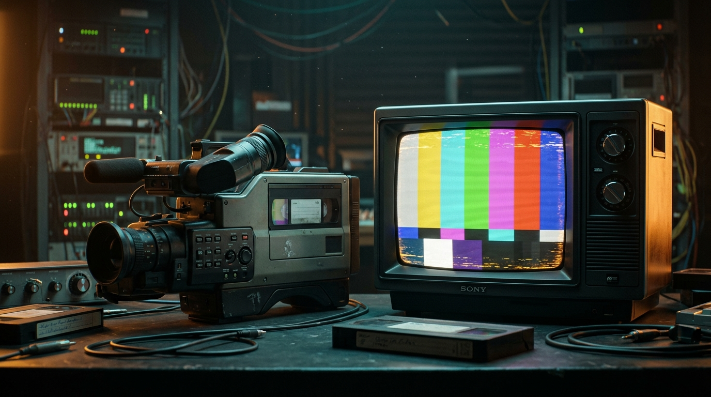

# AnalogTV 3.0 — Live VHS & Composite CRT Camcorder for Android



[](https://github.com/f1nal-b0ss/AnalogTV-Android-Camcorder/actions)
[](https://f1nal-b0ss.github.io/AnalogTV-Android-Camcorder/)
[](https://github.com/f1nal-b0ss/AnalogTV-Android-Camcorder/actions)

**AnalogTV 3.0 for Android** is a native OpenGL ES 2.0 real-time camcorder and composite signal processor inspired by [AnalogTV 3.0](https://analogtv.net/) ([Reddit announcement](https://www.reddit.com/r/iosapps/comments/1xfuicj/analogtv_30_for_iphone_and_ipad_is_out_the/)). Instead of overlaying generic pre-made static textures, it modulates live camera frames into a simulated **YIQ / NTSC composite broadcast signal**, applies authentic RF and VHS tape transport degradation, demodulates back to RGB, and renders through a curved aperture-grille/shadow-mask CRT display pipeline at 60 fps.

---

## Try the Live Interactive Web Camcorder & VHS Converter

**[Launch Live Web Demo (`https://f1nal-b0ss.github.io/AnalogTV-Android-Camcorder/`)](https://f1nal-b0ss.github.io/AnalogTV-Android-Camcorder/)**

The live GitHub Pages web app runs the exact same multi-stage YIQ composite signal shader right in your browser:
- **Live Webcam Camcorder**: Grant camera access to record live video with real-time VHS tracking errors, head-switching noise, Vidicon tube ghost trails, and live OSD telemetry (`PLAY`, `REC`, timecode, and tape counter).
- **Built-in Animated Night Tram Vidicon Scene**: Test all analog signal controls immediately even without a webcam or uploaded video.
- **Upload & Convert Any Video**: Load any `.mp4` / `.webm` / `.mov` clip and record the processed CRT output directly to a downloadable video file.

---

## Core Signal Pipeline & Features

| Stage | Physical Simulation | Real-Time Controls |
| :--- | :--- | :--- |
| **1. YIQ Composite Modulation** | Converts RGB into Luminance (`Y`) and Quadrature Chrominance (`I`, `Q`) with low-pass bandwidth limiting (~1.5 MHz chroma Filter) | **Color Bleed**, **Chroma Delay**, **Cross-Color Rainbow Artifacts** |
| **2. VHS & RF Transport** | Horizontal line-sync jitter, lower-edge head-switching bar distortion, FM snow bursts, and magnetic tape dropouts | **Tape Wear / Noise**, **Tracking Error**, **Horizontal Sync Jitter** |
| **3. Vidicon Camera Tube Lag** | Temporal frame accumulation buffer simulating photoconductive target persistence on bright highlights | **Vidicon Ghost Trails** (phosphor/target decay tail) |
| **4. CRT Display Optics** | Barrel curvature, RGB phosphor triad subpixels, interlaced scanlines, and edge vignette | **Scanline Intensity**, **CRT Curvature**, **6 Instant Presets** |
| **5. Zero-Copy Hardware MP4 Recording** | Dual-pass `EGLRecordable` surface rendering concurrently to `GLSurfaceView` and Android `MediaCodec` + `MediaMuxer` | **One-Tap Live `.mp4` Recording** directly to `Movies/AnalogTV` |

---

## Repository Structure

```text
├── README.md                          # Front-page documentation
├── index.html                         # Live interactive WebGL/Canvas AnalogTV 3.0 Camcorder (Root Pages)
├── docs/
│   ├── index.html                     # Live interactive WebGL/Canvas AnalogTV 3.0 Camcorder (/docs Pages)
│   └── banner.jpg                     # Hero banner asset for GitHub Pages
├── assets/
│   └── banner.jpg                     # Hero banner asset for repository README
├── .github/workflows/
│   └── build-apk.yml                  # Automated GitHub Actions APK CI/CD workflow
├── deploy_github_page.bat             # One-click Windows deployer for @f1nal-b0ss
├── build.gradle.kts                   # Root Gradle configuration
├── settings.gradle.kts                # Android project settings
└── app/
    ├── build.gradle.kts               # App module configuration (CameraX + OpenGL ES 2.0)
    └── src/main/
        ├── AndroidManifest.xml        # Camera & microphone permissions + activity setup
        ├── java/com/retro/analogtv/
        │   ├── MainActivity.kt             # Live Camcorder UI, rotary dials, presets & OSD timer
        │   ├── LiveCamcorderGlRenderer.kt  # OpenGL ES 2.0 YIQ composite + Vidicon trail renderer
        │   ├── AnalogTvParameters.kt       # Signal modulation & CRT physics parameter model
        │   ├── AnalogAudioTapeRecorder.kt  # VHS tape saturation, wow/flutter & hiss audio processor
        │   └── VideoConverterPipeline.kt   # Hardware MediaCodec + MediaMuxer MP4 export pipeline
        └── res/raw/
            └── analog_vhs_fragment.glsl    # YIQ modulation, VHS head-switching & CRT fragment shader
```

---

## Building the Native Android APK

### Automatic Cloud Build (GitHub Actions)
Every push to `main` triggers [`.github/workflows/build-apk.yml`](.github/workflows/build-apk.yml), which compiles the project on Ubuntu with JDK 17 and Android SDK 34:
1. Open the **[Actions tab](https://github.com/f1nal-b0ss/AnalogTV-Android-Camcorder/actions)**.
2. Click the latest **Build AnalogTV Android APK** workflow run.
3. Download **`AnalogTV-3.0-Debug-APK`** from the **Artifacts** section at the bottom of the summary page.

### Local Build (Android Studio)
1. Clone this repository or extract `analog_tv_android_studio.zip`.
2. Open the root folder in **Android Studio Ladybug (2024.2.1)** or newer.
3. Let Gradle sync, then select **Build > Build Bundle(s) / APK(s) > Build APK(s)** or run directly on a physical Android 8.0+ (API 26+) device.
